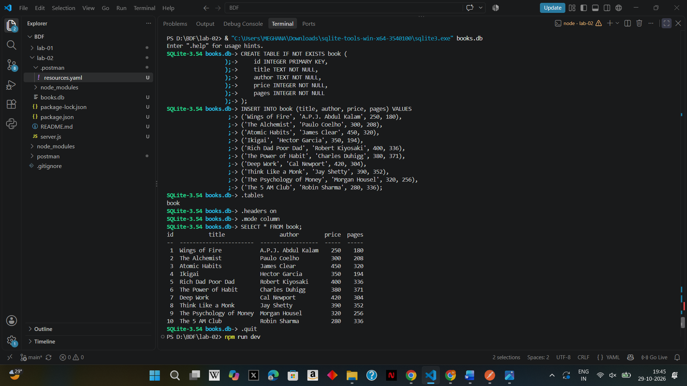
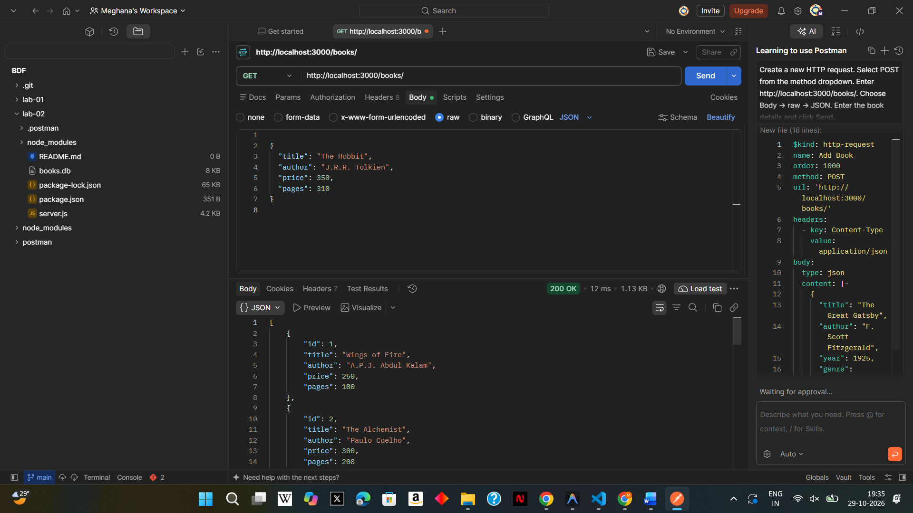
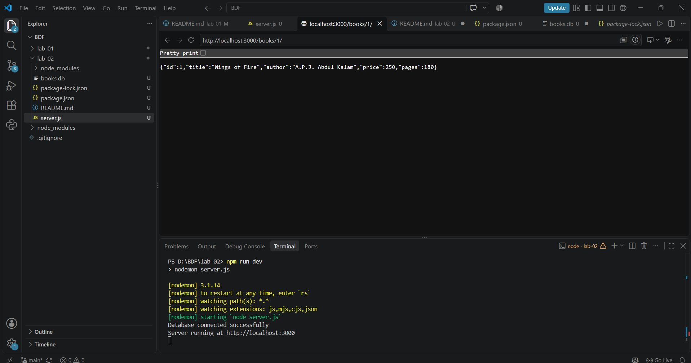
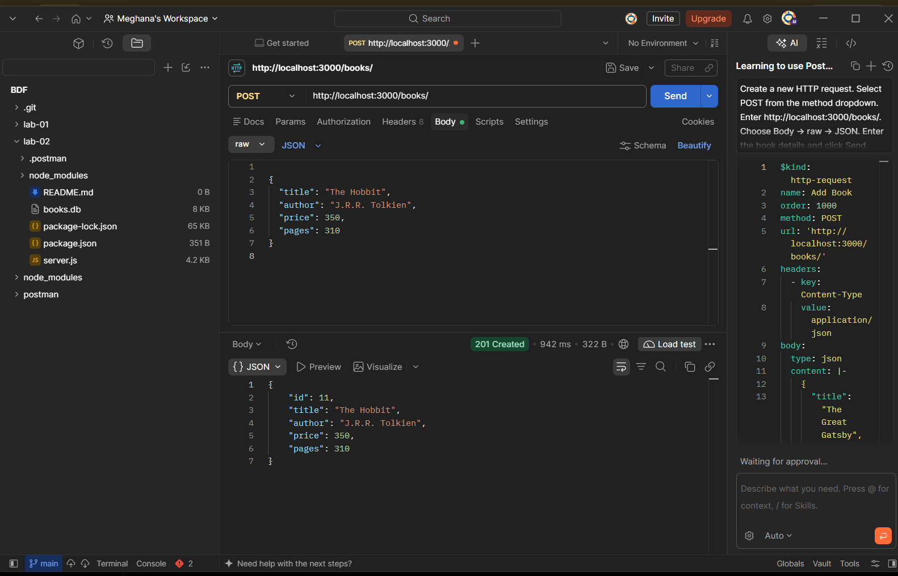
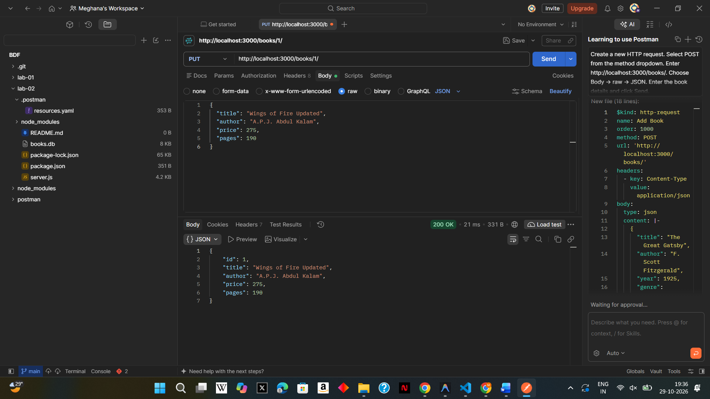
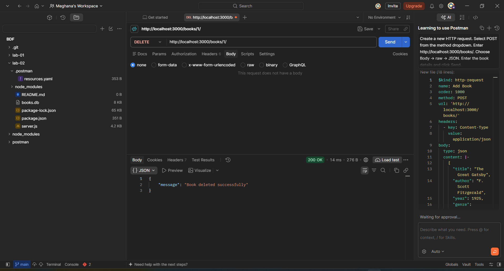
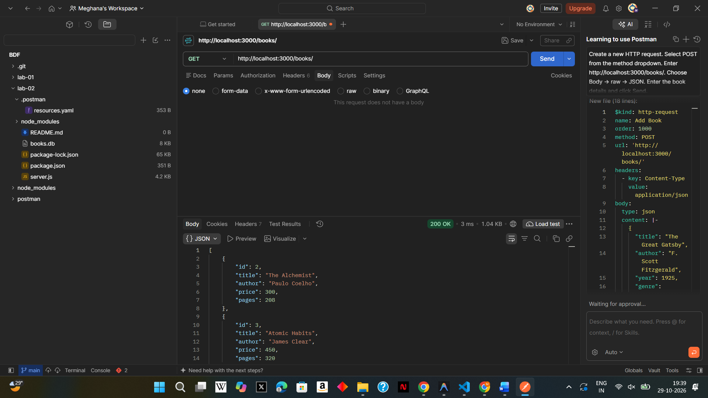
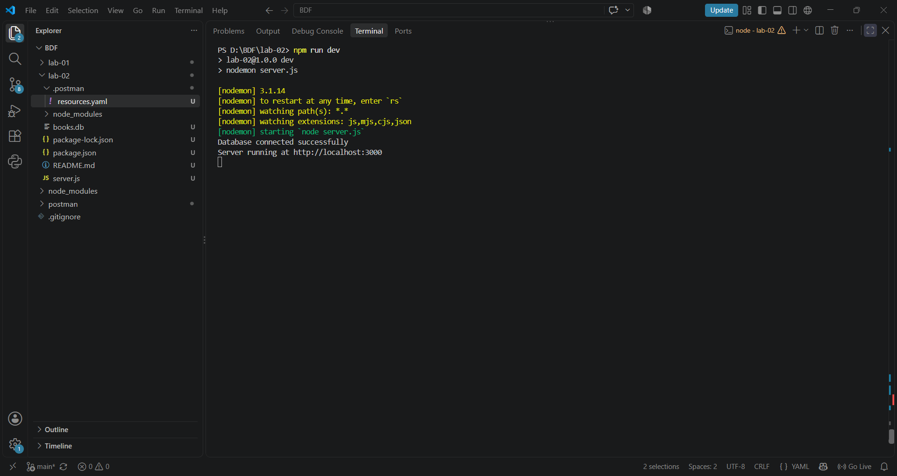

# Lab 2: SQLite Database and CRUD Routes

**Name:** A. Meghana  
**Registration Number:** 252U1R1001 
**Section:** S-15
**Course:** Backend Development Fundamentals  
**Institution:** Aurora Deemed to be University  
**Faculty:** Mr.Shiva Sai Teja

## Live Link

**Status:** Not deployed yet.

This project has been tested locally using Postman. The current version uses a local SQLite database file (`books.db`). Postman screenshots are included as evidence of the working endpoints. A public deployment URL will be added after deployment.

## Objective

To connect an Express server to an SQLite database and implement CRUD operations through HTTP routes.

CRUD stands for Create, Read, Update, and Delete.

## Technologies Used

- Node.js
- Express.js
- SQLite
- sqlite3
- sqlite
- Nodemon
- Postman
- Visual Studio Code

## Project Structure

BDF/
|    lab-02/
|   ├── screenshots/
|   ├── .postman/
|   ├── node_modules
|   │   ├── 1-database.png
|   │   ├── 2-get-all.png
|   │   ├── 3-get-one.png
|   │   ├── 4-post.png
|   │   ├── 5-put.png
|   │   ├── 6-delete.png
|   │   ├── 7-verify.png
|   │   └── 8-serverrunning.png
|   ├── books.db
|   ├── package-lock.json
|   ├── package.json
|   ├── README.md
|   └── server.js
├── node_modules/
├── postman/
└── .gitignore/

The `node_modules` folder is excluded from GitHub using `.gitignore`.

## Requirements

- Node.js and npm
- SQLite command-line tools
- Postman
- Visual Studio Code

## Installation and Setup

1. Open the `lab-02` folder in VS Code.(cd lab-02)
2. Open the terminal and run:

   ```bash
   npm install
   ```

3. Make sure `books.db` is present inside the `lab-02` folder.
4. Start the server:

   ```bash
   npm run dev
   ```

5. The server should start at:

   `http://localhost:3000`

The terminal should display messages confirming that the database is connected and the server is running.

6. Clone the GitHub repository:

   ```bash
   git clone https://github.com/adepumeghana7116-eng/AdepuMeghana.git
   ```

### Environment Variables

No environment variables are currently required by this local version of the project.

## SQLite Database

The database file is named `books.db`. It contains a `book` table with the following columns:

| Column | Data type | Description |
|---|---|---|
| `id` | INTEGER | Primary key |
| `title` | TEXT | Book title |
| `author` | TEXT | Author name |
| `price` | INTEGER | Book price |
| `pages` | INTEGER | Number of pages |

The initial database contains 10 book records.

To view the records using the SQLite CLI, run the following command from the `lab-02` directory in PowerShell:

```powershell
& "C:\Users\MEGHANA\Downloads\sqlite-tools-win-x64-3540100\sqlite3.exe" books.db
```

Then execute:

```sql
SELECT * FROM book;
```

To exit the SQLite CLI, type:

```sql
.quit
```

## API Endpoints

The server provides the following five endpoints.

| HTTP Method | Endpoint | Description |
|---|---|---|
| GET | `/books/` | Retrieves all books |
| GET | `/books/:bookId/` | Retrieves a book by its ID |
| POST | `/books/` | Adds a new book |
| PUT | `/books/:bookId/` | Updates an existing book |
| DELETE | `/books/:bookId/` | Deletes a book by its ID |

### Example POST and PUT Request Body

```json
{
  "title": "The Hobbit",
  "author": "J.R.R. Tolkien",
  "price": 350,
  "pages": 310
}
```

## Testing

All five API endpoints are tested using Postman.

- GET requests retrieve book records.
- POST adds a new book.
- PUT updates an existing book.
- DELETE removes a book.
- A final GET request verifies the database changes.

Parameterized SQL queries with `?` placeholders are used for queries that accept user input.

## Screenshots

### 1. SQLite Database



### 2. GET All Books



### 3. GET One Book



### 4. POST — Add a Book



### 5. PUT — Update a Book



### 6. DELETE — Delete a Book



### 7. Verify Database Changes



### 8. Server Running



## Problems Faced and Solutions

1. **SQLite command-line setup:** I extracted the SQLite tools and used the `sqlite3.exe` executable to create and inspect the database.
2. **Database connection:** I connected the Express application to `books.db` and used an asynchronous initialization function to start the server after the database connection succeeded.
3. **Testing HTTP methods:** I used Postman to test GET, POST, PUT, and DELETE requests and check their responses.
4. **Verifying database changes:** I used GET requests and SQLite queries to inspect the records after changes.

## Conclusion

This lab helped me understand how to connect an Express server to an SQLite database and implement CRUD operations. I learned to test HTTP endpoints using Postman, use parameterized SQL queries, and verify database changes.

